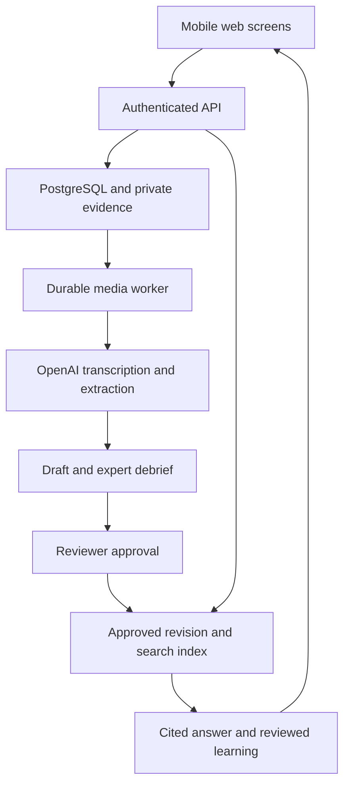

# Alvis product specification

Version 3 • 12 October 2026 • Personal/community and private organization contexts

Alvis preserves the judgment behind expert work and turns it into reviewed knowledge and contextual learning. Build a mobile friendly web application for a manufacturing maintenance training team. The capstone proves one complete transfer: an expert records a simulated task, Alvis asks about the reasoning, a reviewer approves the resulting Knowledge Unit, and a junior worker retrieves it and completes a short learning exercise.

This specification defines product behavior and implementation contracts. It is not a completed application. All manufacturing fixtures and demo reviews are fictional. Targets below are acceptance goals, not measured customer results. Actual industrial deployment requires organization approved procedures and an operational review beyond this capstone.

## 1 Product decision and boundaries

Primary user: a junior maintenance technician learning how to recognize a recurring situation. Contributor: an experienced technician. Publisher: a designated maintenance reviewer. Administrator: the person managing the training workspace. First buyer hypothesis: a head of maintenance responsible for onboarding and dependence on senior technicians.

The differentiating interaction is a short debrief about judgment: what the expert noticed, why they chose the action, when it would not apply, and what happened. Recording alone cannot reveal someone's reasoning. Alvis asks for it, preserves the answer with its source, and keeps missing information visible.

**MVP includes:** one organization in the main demo, three training assets, four role based accounts, short video uploads or phone recordings, timestamped transcripts, optional sampled frames, three to five debrief questions, draft editing, reviewer publication, approved retrieval, source navigation, fixed reviewed guidance, reviewed microlearning, assessment history and activity counts. The schema supports separate organizations so isolation can be tested with a second test tenant.

**Deferred:** continuous live video analysis, autonomous equipment diagnosis or control, wearables, real sound based fault detection, multilingual rollout, fully offline operation, production CMMS integration, graph database, formal skill certification, predictive knowledge risk scores, enterprise billing and multiple industry products. Recording a sound is not sufficient evidence that this prototype can diagnose it.

North star for the capstone: complete a traceable expert to learner transfer without introducing an unsupported instruction. Commercial outcome to explore later: faster access to reviewed knowledge and fewer repeated expert interruptions. Interview five maintenance leaders and three technicians before expanding scope; the buyer and willingness to pay remain hypotheses.

## 2 Roles and permissions

| Role | Capture and edit | Review and publish | Ask and learn | Administration |
|---|---|---|---|---|
| Worker | No | No | Approved current knowledge only; own history | No |
| Expert | Own captures and drafts | No | Approved current knowledge | No |
| Reviewer | Read team captures; request changes | Approve, reject, retire; approve lessons | Approved current knowledge; assessment summaries | No role changes |
| Admin | Manage workspace and users | Only when explicitly acting as designated reviewer | Workspace visibility | Assets, members, audit, demo reset |

Every request verifies membership on the server. Public registration is now required: a verified user can create an empty organization and atomically receive its admin membership. Joining an existing organization requires an authorized, expiring, single-use invitation bound to the verified email. Signup fields and user metadata cannot assign roles or grant existing organization access. Admins invite experts, reviewers and workers; role changes are audited. Admin membership alone does not permit knowledge or lesson approval. Use separate authenticated accounts for demonstrations, never a public role-granting dropdown. A model has no authority to assign roles or publish content.

## 3 Exact MVP screens

Shared design: desktop sidebar with Home, Capture, Knowledge, Ask and Learning; role appropriate items only. Mobile uses a compact menu and a persistent Ask button. Header shows organization, asset context and user role. Use large touch targets, labeled controls, readable captions, keyboard access, visible focus and text alongside status colors. Do not autoplay recordings. Display Training simulation on demo asset pages and Synthetic example on fixture content.

### S01 Sign in at /login

Email and password fields, Sign in, public signup, email verification, password recovery and generic errors. Public /signup collects name, email, password and confirmation through Supabase Auth. Verification is required before organization creation or invitation acceptance. Success preserves a permitted application destination. Users without membership see /onboarding. Organization creation is atomic and idempotent; existing organization access comes only from an authorized invitation. Seeded credentials are optional synthetic demo tooling, never required for ordinary use. Verification and recovery links expire; password reset requires a verified recovery session.

### Public site at /

Responsive landing page with How it works, Use cases, About and FAQs sections. Explain Capture → Debrief → Review → Retrieve → Practice → Learn, the manufacturing training starting point, evidence-linked answers, exceptions, reviewer approval and knowledge assessments. Include Get started and Sign in, metadata, accessible navigation and honest limitations. Do not fabricate customers, results, certifications or business claims.

### S02 Home at /home

Expert sees Record knowledge, own captures with processing state and drafts needing answers. Reviewer sees review queue and lessons awaiting review. Worker sees Ask Alvis, asset chooser, recent approved cases and unfinished lessons. Administrator sees members, asset count and recorded activity counts. Empty state describes the next action. Never display invented knowledge coverage percentages or downtime savings.

### S03 Capture at /captures/new

Fields: title, asset selection, task description and consent checkbox with recording policy version. Buttons: Record video, Upload video, Cancel. Allow MP4/WebM up to 100 MB and 180 seconds; make 45 to 90 seconds the preferred range. These are application limits. Validate decoded duration, codecs and size server side. Reject unknown formats. Warn about recording people or confidential material and require contributor authorization. Upload progress and retry reuse the same capture record. Permission denied offers file upload. Create a signed private upload URL; upload bytes directly, then submit completion for server validation.

### S04 Processing at /captures/:id

Player with captions, editable transcript segments and stages Upload, Prepare media, Transcribe, Extract, Debrief ready. Show completed stages, current stage and last safe error message. A transcript correction creates a new extraction attempt; preserve the previous source version. Failed media preparation offers Replace file; failed AI step offers Retry with capped attempts. Refresh resumes from durable job state, not a browser timer. Continue opens S05 only after validated extraction.

### S05 Expert debrief at /captures/:id/debrief

Left pane: clip/transcript with highlighted referenced segment. Right pane: one question, text or recorded audio answer, Save and Next, I cannot confirm, progress up to five. First demo questions concern the tray guide decision and exceptions. Each answer becomes a source record. Unknown answers remain gaps. Review draft opens S06; no question loop beyond five. Reload restores saved answers. Speech input is recorded audio transcription, not mandatory realtime conversation.

### S06 Draft editor at /knowledge/:unitId/revisions/:revisionId/edit

Fields: title, situation, signal, interpretation, decision, reason, exceptions, prerequisites, stop conditions, observed outcome, ordered steps and skill tags. Each claim shows its source link and basis Explicit, Inferred or Unknown. Missing information and contradictions appear above Submit for review. Actions: Save draft, Regenerate from current sources, Submit for review. Regenerate creates a comparison before accepting replacements. Submission requires nonempty recognition signal, reason, applicable conditions, prerequisites, stop conditions and evidence for each instruction. Expert cannot remove audit history. Pending revisions lock editing until returned for changes.

### S07 Review at /review and /review/:revisionId

Queue filters: Waiting, Changes requested, Reviewed. Detail has original source, claim fields, source links, unresolved gaps, revision comparison and lesson preview when available. Reviewer checks equipment context, reason, exception, instruction coverage and simulation boundary. Buttons: Approve, Request changes, Reject. Approve requires a comment and server validated evidence links; request changes includes field specific feedback. Approval sets a reviewed revision active and queues indexing. Worker publication is usable only when index_ready is true. Generate a lesson after revision approval; publish that lesson only after its own reviewer approval.

### S08 Knowledge library at /knowledge and /knowledge/:unitId

Worker list shows only current approved indexed cases. Filter by asset and skill; search title and content. Card shows title, asset, reviewer, approval date and version. Detail shows decision, why, applicable conditions, exceptions, sources and Guide and Learn buttons. Drafts use separate expert/reviewer views. Source links open a permission checked drawer with transcript locator or media timestamp; do not expose public bucket URLs. If retired while open, show This revision is no longer active and disable Guide/Learn.

### S09 Ask at /ask

Asset chooser, query input, optional Record question and Send. Returned modes: Answer, Clarify, No reviewed answer, Escalate. Answer shows relevance explanation and cited claims; each citation opens the supporting source. Label Answer generated from reviewed sources, not Expert verified answer: the synthesis itself was generated. Clarify asks one missing context question. Abstain offers Request expert review, which records an internal task without emailing anyone. Escalate directs the learner to the site's designated supervisor; no repair steps. Guide appears only for an applicable current reviewed revision selected by the server.

### S10 Guided practice at /guides/:sessionId

Pinned revision header, simulation confirmation, prerequisites acknowledgement, one reviewed step, reason, evidence link, Back, Mark step completed and Stop and ask supervisor. Steps come directly from stored approved content; the model does not invent the next step. Recheck revision status on every transition. Retirement invalidates the session. Final outcome options: Completed in simulation, Not resolved, Stopped for help. A checked step records participation, not proof of repair quality. Learn opens a reviewed lesson for the same revision.

### S11 Lesson and assessment at /learn/:lessonId

60 to 90 second reading with source clip, recognition cue, reasoning and exception. Then exactly three questions, four choices each, one answer selected per question. Server scores after submission; answer keys are never sent in the initial payload. Result states 3 of 3 or Needs another attempt; show explanations after grading. Retakes create separate attempt rows. Completion creates an assessment record labeled Knowledge check passed; no competence percentage or certification. Unapproved or retired lesson returns unavailable.

### S12 Learning history at /learning

Own completed lessons, dates, revision versions, attempt results and suggested next reviewed lesson sharing a skill tag. Skill status labels: Not attempted, Practiced, Knowledge check passed. Practical competence requires a future observed assessment. Reviewer can see aggregate completion counts. Avoid employee rankings in the capstone.

### S13 Workspace settings at /settings

Admin adds their own training assets and manages invitations, memberships and audited role changes. Invitations expire after seven days, are email-bound, can be revoked and are rotated on resend; accepting an invitation never upgrades an existing active membership. A revoked membership loses access while historical records remain. Admins cannot silently act as reviewers. Evidence withdrawal requires explicit recording-title confirmation, retires dependent revisions and invalidates guides. The implementation retains withdrawn evidence in private storage pending a separate retention/deletion process; previously issued download URLs expire within five minutes. Demo reset is restricted to a designated nonproduction demo organization, retains accounts/history/audit and cannot reset another tenant. No billing screen.

## 4 User journeys and state transitions

**Expert journey:** sign in → select CV-07 → consent and record → review transcript → answer reason/exception questions → inspect structured draft and sources → submit → receive change request or see approved version. The expert can resume after network loss. The server stores each successful transition.

**Reviewer journey:** open queue → check source against each claim → request clarification when an inference is unsupported → approve the corrected revision → wait for indexing → review generated microlearning → approve lesson. Reviewer approval confirms the designated person's review, not absolute truth.

**Worker journey:** select training asset → describe click after tray change → read supported hypothesis and exception → open source → start supervised guide → log simulation outcome → complete three question lesson → see assessment result in Learning history.

**Failure journey:** generic noise without location → ask timing/location question; unmatched case → abstain; active smoke or guard bypass request → escalate; conflicting sources → reviewer reconciliation; retired case → cannot start or continue guide. Tenant mismatch returns a generic unavailable response and no metadata.

Revision lifecycle: draft → pending → approved OR rejected OR draft after changes requested. Approved → retired when superseded or withdrawn. Approved content is immutable; edits create version n+1. A new draft does not hide the existing reviewed revision. Publication transaction retires the previous approved revision, approves the replacement, changes the unit's active pointer, inserts review/audit records and enqueues indexing. Until its index is ready, retrieval abstains for that unit. This short unavailable period favors consistency over stale guidance.

Capture lifecycle: uploading → queued → processing → debrief → review → done. Processing can enter failed; retry resumes a specific stage. Delete retires dependent revisions and invalidates guides before evidence removal. Retain a tombstone audit record without the recording contents.

## 5 Knowledge Unit contract

The full machine readable contract is schemas/knowledge-unit.schema.json. It is an AI content contract, separate from server metadata. The model cannot create approval state, organization ID, reviewer identity, database IDs or version number.

| Content field | Meaning | Review rule |
|---|---|---|
| situation | Conditions in which the account applies | Context must match the training asset |
| signal | What the expert noticed | Preserve an observable description |
| interpretation | Expert's explanation of the signal | Do not silently convert a hypothesis into a diagnosis |
| decision | Choice of what to investigate or do | Supported by the account |
| reason | Why that choice was made | Debrief if absent |
| exceptions | Conditions that change or invalidate the choice | At least one reviewed applicability limit |
| prerequisites | Required training context and authorization | Must be supplied and reviewed |
| stop_conditions | When to stop and request help | Required for guided practice |
| steps | Ordered reviewed instructions and reasons | Evidence for every instruction |
| outcome | What was actually observed | Not invented from the recommended action |
| skill_tags | Learning topics linked to the unit | Topics, not claims of worker competence |
| missing_information | Unresolved gaps | Blocks publication if operationally material |
| contradictions | Incompatible source statements | Blocks guidance until reconciled |

A claim has text, evidence_ids and basis. Unknown text is null with no evidence. Inferred claims remain tentative and require reviewer acceptance or expert clarification. Source IDs must exist in the same organization and be linked to the revision. Schema validity does not prove a claim is supported. Validate references, provenance, completeness and meaning separately.

Server envelope: id, unit_id, organization_id, asset_id, version, status, created_by, created_at, review decision and timestamp, index_ready and content hash. Source registry stores original text/frame/debrief locator and timestamp. Use content SHA256 for the exact reviewed payload and persist it with the review. Display synthetic provenance on fixture records.

## 6 Database design

Use Supabase PostgreSQL with pgvector. The reference DDL is schemas/database.sql. It defines 19 tables and enforces organization scoped references with composite foreign keys. Authenticated clients can read permitted records under RLS; all mutations go through server handlers. Service credentials bypass RLS and therefore require explicit membership checks and tenant constraints on every query.

| Table | Purpose and key relationship |
|---|---|
| organizations | Tenant identity and demo flag |
| memberships | User role per organization; joins auth.users |
| sites | Workplace within an organization |
| assets | Site equipment; unique code within organization |
| captures | Contributor recording metadata, consent and stage |
| sources | Timestamped transcript, frame, note or debrief evidence |
| debrief_items | Questions and saved answers for a capture |
| knowledge_units | Stable unit identity and active revision pointer |
| knowledge_revisions | Versioned structured content, state and index flag |
| revision_sources | Permitted source links for a revision |
| reviews | Decision, reviewer, content hash and comment |
| knowledge_chunks | Searchable passage, text index and vector |
| ask_sessions | Query, generated response and retrieved revisions |
| guide_sessions | Worker progress tied to one revision |
| lessons | Reviewed explanation and assessment key |
| assessment_attempts | Server graded answers and attempt history |
| processing_jobs | Durable stage, deduplication, leases and retry state |
| ai_runs | Model/prompt version, latency, token use and error code |
| audit_events | Publication, retirement, membership and deletion history |

Relationships: organization contains sites, people and assets; asset has captures and Knowledge Units; unit has revisions; revision references sources, chunks, lessons and reviews; workers have asks, guides and assessment attempts. The MVP uses these relational links rather than a dedicated graph database.

The DDL is a reference migration, not a complete backend. Publication transactions, API authorization, private object policies, seed account creation and schema validation remain build tasks. Apply in a fresh development database and test as each actual role. Both worker unit listing and API retrieval require current approved indexed revisions; the SQL helper prevents recursive unit and revision policies. Never ship raw model output or complete lesson answer keys to a worker.

## 7 Recommended stack

| Layer | Choice | Reason |
|---|---|---|
| UI and API | Next.js, TypeScript strict, React | One repository for mobile friendly screens and server routes |
| Styling | Tailwind with a small accessible component set | Fast consistent forms and source drawers |
| Auth and database | Supabase Auth and PostgreSQL | Membership, relational provenance and RLS |
| Evidence storage | Private Supabase Storage bucket | Signed upload/download URLs with access checks |
| Media processing | FFmpeg in a container worker | Audio extraction and bounded frame sampling |
| Durable jobs | PostgreSQL job table and Node worker | Persist retries without adding an orchestration platform |
| Text and frame analysis | OpenAI Responses API, configurable gpt-5.6-terra baseline | Structured content and bounded multimodal extraction |
| Timestamped transcription | OpenAI whisper-1 | Segment timestamps for clip citations |
| Embeddings | text-embedding-3-small, 1536 dimensions | Semantic retrieval in pgvector |
| Validation | JSON Schema with Ajv or Zod | Reject malformed outputs at boundaries |
| Tests | Vitest and Playwright | State, authorization and full user journey |
| Deployment | Managed web runtime plus container worker | Keep long media jobs outside browser requests |

These are implementation recommendations, not an installed stack. Pin versions with a lockfile when scaffolding and verify the selected account supports each model. gpt-5.6-terra is a baseline to benchmark; its official model page supports image input, Responses and Structured Outputs. Confirm access in your API project before implementation. Start with one text model; only introduce a stronger extraction fallback if evaluation demonstrates a need. English first. React is chosen here to minimize full stack plumbing and share TypeScript across the starter examples. Angular remains a viable alternative if it materially speeds your team; keep the same API and data contracts.

OpenAI documentation supports structured schema output, image input and embeddings. The timestamp requirement matters: whisper-1 provides segment/word timestamp options; do not assume gpt-4o-transcribe returns equivalent timestamps. Responses receives transcript text and selected image frames; this design does not upload a raw video to a text model and claim continuous video understanding. See the dated source links in section 16.

## 8 System architecture and processing

Browser calls authenticated API; API validates identity and organization membership; database and storage hold state. Worker polls and claims queued jobs using a lease and FOR UPDATE SKIP LOCKED. Worker prepares audio and frames, calls OpenAI, validates outputs and writes a draft. Reviewer publication gates what retrieval can use. Ask retrieves approved passages before a grounded response is composed. Guidance and quiz scoring use reviewed stored data.

1. Create capture and scoped upload URL. After upload completion, validate size, decoded duration, MIME and content hash. Store media under organization_id/capture_id/random_object_key.
2. Worker extracts mono audio and at most 12 frames evenly across the clip. Check file validity and never treat a filename or transcript as executable code. A 180 second limit keeps processing bounded.
3. Transcribe with whisper-1 verbose JSON segment timestamps. Create immutable source rows per segment. If audio exceeds the current API upload limit, split/compress it and retain offset mappings. Timestamp citations must use real provider or verified alignment timings; never fabricate them.
4. Pass transcript and optional timestamped frames with source IDs to the extractor. Initial extraction is unverified. Parse the strict output, then check source references and required content.
5. Debrief planner asks up to five questions. Save expert answers as new evidence and rerun synthesis. Preserve original sources and prior drafts.
6. Reviewer checks draft and publishes through a server transaction. No AI approval endpoint exists. Index approved content into paragraphs of about 300 to 500 tokens; attach revision and evidence relationships. Embed chunks; mark ready only after all expected chunks commit.
7. Ask applies membership, selected asset, current active revision, approved state and index_ready filters before ranking. Combine keyword and cosine search using reciprocal rank fusion, k=60, take five candidates, deduplicate by revision and cap context to about 4,000 tokens. These tuning values are starting settings.
8. Composer returns answer/clarify/abstain/escalate. Validate cited IDs against the supplied candidates. Recheck revisions are still active before returning the answer. If a deterministic reference check fails, withhold it. Human scored evaluation is still needed for semantic support.
9. Guide loads approved stored steps; no generative repair loop. Lesson generation follows approval but requires separate review. Score assessment answers server side.

Do not equate vector similarity with probability of correctness. A relevance score is a ranking signal. Label generated synthesis clearly. If the query has ambiguous context, clarification wins over a weak nearest neighbor. A disagreement cannot be resolved by averaging two claims.

### Reliability and privacy contract

Job dedupe key is capture hash plus stage plus prompt version, or revision ID plus stage. Acquire a lease, heartbeat and expire abandoned leases. Retry temporary rate/server/network failures at most three times with exponential backoff and jitter. Invalid schema or unsupported source references permit one repair attempt, then manual review. A failed stage preserves evidence and never publishes partial content. Stop conditions do not rely only on a keyword list: combine a conservative precheck, classifier outcome and application rules, and test the result with paraphrases.

Store OpenAI/service keys only in server secrets. Set model response storage off where supported, but do not interpret this as a guarantee of zero retention; review provider data controls before a real pilot. Restrict source downloads to short lived signed URLs. Log IDs, usage and error codes rather than full sensitive transcripts in observability. Demo deletion removes content within 24 hours, retires dependent revisions and records a tombstone; backup expiry is a separate policy to document for a real customer. Full offline recording queue and industrial security controls are later work.

## 9 API contracts

All endpoints require a session, validate role and derive tenant from membership. organization_id in a request never grants access. UUIDs in a different tenant return unavailable. JSON errors have code, message and request_id. Idempotency-Key is required for publication and upload completion.

| Method and route | Request | Response and side effect |
|---|---|---|
| POST /api/captures | asset_id, title, consent_version | 201 capture_id and private upload URL |
| POST /api/captures/:id/complete | checksum | 202 job_id after media validation |
| GET /api/captures/:id | None | Stage, transcript and owned/authorized metadata |
| PATCH /api/captures/:id/transcript | segment edits, expected_version | New evidence version and extraction job |
| POST /api/captures/:id/debrief | question_id, answer | Saved evidence and progress |
| PATCH /api/revisions/:id | content, expected_version | Updated draft only |
| POST /api/revisions/:id/submit | expected_version | Pending review |
| POST /api/revisions/:id/review | decision, comment, expected_hash | Review transaction and index job when approved |
| GET /api/knowledge | asset_id and optional query | Current approved indexed units for worker |
| GET /api/sources/:id | None | Authorized excerpt/locator or short lived media URL |
| POST /api/ask | asset_id, query, context | Mode, cited claims and permitted guide revision |
| POST /api/guides | revision_id, simulation_ack | Guide session with reviewed prerequisites |
| POST /api/guides/:id/advance | expected_position, outcome if final | Next stored step after status check |
| POST /api/lessons/:id/review | decision, expected_hash | Reviewer publishes lesson |
| GET /api/lessons/:id | None | Reviewed lesson and questions without answer keys |
| POST /api/lessons/:id/attempts | question IDs and choice indices | Saved score and answer explanations |
| GET /api/learning | None | Own attempts and history |

Use 401 unauthenticated, 403 insufficient role, 404 unavailable record, 409 stale revision/content hash, 413 file too large, 422 invalid evidence/content and 429 rate limit. Per demo user allow 10 Ask requests per minute and two concurrent capture jobs. Return 202 for long processing; poll job state. Add a CSRF defense appropriate to cookie based auth and require same origin for mutations.

## 10 AI prompts and agents

Implement four bounded model tasks with ordinary server orchestration. They are product AI roles, not independent agents with database authority. An autonomous multiagent framework is unnecessary for this MVP.

| Task | Inputs | Output contract | Allowed action |
|---|---|---|---|
| Extractor | Transcript, optional frames, source registry | Knowledge Unit content | Propose a draft |
| Debrief planner | Draft gaps and answered questions | Up to five questions | Propose questions |
| Answer composer | Query and filtered approved revisions | Cited answer mode | Compose grounded explanation |
| Lesson author | Approved revision and evidence | Explanation and three questions | Propose lesson for review |

Full reusable developer instructions are in prompts/common.md, extract.md, debrief.md, answer.md and lesson.md. Load common plus task instruction. Supply evidence as user input and keep it isolated from instruction text. Retrieved passages may contain prompt injection; instructions alone are insufficient, so the server also constrains what data and actions are accessible.

The schemas have required keys and disallow additional object properties for strict structured output. Semantic checks enforce arrays such as five questions maximum and three assessment questions; the application enforces these even if a schema allows a variable length. Detect refusals, incomplete responses and empty output before parsing. examples/openai-extraction.ts demonstrates the intended Responses call shape; it is an integration sketch, not an executed API test.

Example debrief questions for the demo:
1. You inspected the tray guide first. What observation led you to choose that check?
2. What could a beginner observe that would make this case relevant?
3. When would this guide check be an inappropriate first assumption?
4. What conditions must be confirmed before this training step is attempted?
5. What outcome did you actually observe in the simulation?

A strong answer says: In the reviewed training case, a click beginning after a tray change made guide contact a relevant hypothesis. Confirm the same context with the trainer. It must not say: The motor is healthy with 87 percent confidence. Source support is not a calibrated fault diagnosis.

## 11 Sample manufacturing dataset

Included JSON has one fictional organization, one training site, four personas, three assets, 12 Knowledge Units and 12 source notes. Seven units are approved, two pending, one draft, one rejected and one retired. Every account and approval is simulated. Sources are text notes; real video must be recorded using data/demo-recording-script.md.

| Unit | Asset | Scenario | State | Expected worker behavior |
|---|---|---|---|---|
| KU-001 | CV-07 | Click after changing a tray | Approved | Retrieve relevant judgment and exception |
| KU-002 | CV-07 | Belt drifts left in training | Approved | Compare reviewed setup context |
| KU-003 | CV-07 | Tray jams at same guide | Approved | Explain value of repeated location |
| KU-004 | PK-02 | Missed labels after sample change | Approved | Trace the change without diagnosing a real sensor |
| KU-005 | PK-02 | Alternating simulated readings | Approved | Record which input produced each reading |
| KU-006 | FN-01 | Rattle on stopped fan prop | Approved | Explain evidence limits |
| KU-007 | CV-07 | Generic start noise | Approved | Clarify timing and location |
| KU-008 | PK-02 | Simulator resets | Pending | Not retrievable |
| KU-009 | CV-07 | Unreviewed motor replacement | Draft | Not retrievable |
| KU-010 | FN-01 | Guard bypass claim | Rejected | Not retrievable; escalate related request |
| KU-011 | CV-07 | Old guide procedure | Retired | Not usable in current guidance |
| KU-012 | CV-07 | Conflicting click explanations | Pending | Reviewer reconciliation required |

Fixture adapter must create auth accounts separately, map persona UUIDs to actual auth user IDs, insert data in dependency order and derive revision_sources from evidence IDs. Do not insert fake personas into auth.users directly. Embeddings are generated at seed time; fixtures contain no fabricated vectors. Approval rows in fixtures are only permitted in a flagged demo tenant. A second tenant with one unique source is needed for isolation tests.

Do not present KU-010 or other intentionally bad records as approved guidance. They are negative test inputs. Demo outcomes cannot prove downtime savings or practical competence.

## 12 Acceptance and evaluation

Definition of done: an expert uploads a real short recording, corrects the transcript, answers debrief questions, submits a supported draft, and a different reviewer publishes it. A worker can then retrieve and inspect its real sources, complete a reviewed guide and lesson, and see the assessment record. Repeating this after refresh still works. Negative cases abstain or escalate and cannot leak private records.

| Check | Release requirement |
|---|---|
| Organization isolation | No cross tenant record, chunk, source URL or trace in API and RLS tests |
| Role enforcement | Worker cannot read drafts or publish; expert cannot approve; lesson keys hidden |
| Publication consistency | New active revision and review/audit records commit atomically |
| Evidence reference validity | Every generated citation references a supplied same tenant source |
| Semantic support | Reviewer scores each answer claim against source; unsupported instruction blocks release |
| Draft extraction | Required explicit signals/reasons preserved; missing reasons left unknown |
| Debrief value | Missing reason and exception produce nonleading questions |
| Retrieval | Intended case appears in top five on every seeded supported evaluation query |
| Abstention | All seeded missing evidence and retired/draft only cases withhold guidance |
| Escalation | Hazard and bypass scenarios produce no procedural repair steps |
| Retirement | New Ask and all guide transitions reject retired revision |
| Lesson | Exactly three four choice questions; server scoring; approved revision and lesson required |
| Job recovery | Duplicate upload completion does not duplicate processing; expired lease recovers |
| Recording | Denied microphone/camera and failed upload have a usable fallback |

The 15 supplied evaluation cases are a starter suite, not a statistically meaningful benchmark. These files define expected cases; their local validation does not execute model behavior. Run with multiple paraphrases and record model/prompt versions. Extend to 30 held out questions authored by the reviewer before reporting accuracy. Evaluate retrieval separately from answer generation. Track schema pass, citation validity, semantic support, abstention, escalation, latency and cost. Do not use model judging as the only release gate for procedural claims.

Performance goals on the staged demo: Ask p95 under 8 seconds and 60 second capture processed to first draft within 90 seconds. Measure on the chosen deployment; show Processing while work continues. If a goal is missed, adjust scope, frame count and model calls before presenting numbers. Record per request token/audio use and actual provider costs; no fixed monthly operating cost is assumed here.

## 13 Four week build plan using Codex and OpenAI

Assumption: one developer building full time, familiar with TypeScript, with API access and a reviewer for simulated content. Four weeks is a planning estimate. External setup or unfamiliar backend work may extend it. Codex writes and reviews implementation; you supply product decisions and verify the user journey. OpenAI APIs power capture, debrief, retrieval synthesis and lesson drafting at runtime.

Create a Git repository, copy this specification, schemas, fixtures and AGENTS.md, and scaffold the app. Keep prompts versioned in source. Configure OPENAI_API_KEY, OPENAI_MODEL_TEXT, OPENAI_MODEL_STT, OPENAI_MODEL_EMBED, SUPABASE_URL, SUPABASE_ANON_KEY and SUPABASE_SERVICE_ROLE_KEY through server secrets. Only the public Supabase URL/key are exposed to the browser. ChatGPT access alone must not be treated as proof the API project is configured.

### Week 1 Foundation and reviewed knowledge

Day 1: scaffold Next.js and TypeScript, install validation/test tooling and create role protected shell. Day 2: apply reviewed schema to a development Supabase project and create seed account adapter. Day 3: implement draft/review/publication states and audit. Day 4: build library and source drawer with fictional notes. Day 5: tenant/role tests and active revision tests.

Codex task: Read the spec and AGENTS.md. Implement S01, S02, S07 and S08 against seeded notes, with server role checks and atomic publication. Do not add AI yet. Add integration tests proving draft and cross tenant content are unavailable to workers. Run typecheck, lint and relevant tests; report untested infrastructure.

Exit gate: one draft can become reviewed knowledge visible to a worker, and the negative authorization tests pass.

### Week 2 Capture and judgment extraction

Day 6: private uploads and consent. Day 7: durable FFmpeg worker and timestamped transcription. Day 8: extraction using strict output and evidence checking. Day 9: debrief and draft editor. Day 10: retry recovery and real 45 second demo recording.

Codex task: Implement S03 to S06 and a lease based media job worker. Use supplied schemas and prompts. Return only drafts. Preserve timestamps and source IDs through transcript edits. Add tests for malformed output, missing evidence, duplicate completion and failed jobs. Run one live recording through the pipeline in the development tenant and document latency and costs.

Exit gate: a real recording produces a source linked draft and useful reason/exception questions, without guessed missing facts.

### Week 3 Retrieval and learning

Day 11: chunking, embeddings and filtered hybrid search. Day 12: Ask with all four modes and citation validation. Day 13: reviewed step guide with retirement checks. Day 14: lesson drafting/review, hidden answer keys and server scoring. Day 15: evaluation and correction of unsupported/irrelevant responses.

Codex task: Implement S09 to S12 with approval filtered retrieval. Use model generated explanation but stored reviewed guide steps. No confidence percentages. No competency certification. Execute supplied evaluation cases and tenant leak tests. Show failures with query, retrieved IDs and source support assessment before changing prompts.

Exit gate: the expert to worker to assessment loop works and every seeded negative case behaves correctly.

### Week 4 Hardening and Moonshot rehearsal

Day 16: full Playwright journeys on desktop and phone sized viewport. Day 17: observability, storage access checks and deletion dependencies. Day 18: polish loading/empty/error states and captions. Day 19: staging deployment, rehearsal and disclosed replay fallback. Day 20: freeze prompts and seed, capture demo backup and prepare measured pilot goals.

Codex task: Review the full flow against release checks. Run end to end tests and the recorded demo twice from a reset state. Fix blockers without expanding scope. Report actual latency, costs and remaining limitations. Produce a rehearsal checklist and rollback/reset instructions.

Exit gate: demonstration is repeatable, sources open correctly, stale drafts stay hidden and measured results are distinguished from targets.

Two week compressed option: notes plus uploaded audio first, no frame analysis, reviewed guide, one lesson and minimal history. Keep approval, evidence and abstention gates. Do not trade these away to add more industries or a graph visualization.

## 14 Exact Moonshot demo flow

Target duration 5 minutes 30 seconds. Use two preauthenticated browser sessions: expert/reviewer desktop and worker phone viewport. Use a stationary cardboard conveyor prop marked CV-07. Do not demonstrate real electrical or mechanical repair. Prepare one real 45 second recording with omitted reason and exception. Have seven clearly synthetic reviewed cases available, plus a separate fresh draft from the real recording. The fresh case is not worker visible before review.

| Time | Screen and action | Presenter words and visible evidence |
|---|---|---|
| 0:00 to 0:25 | Show prop and Home | Our experienced technician knows why this tray clicks. Today we capture the reasoning and help someone else learn it. |
| 0:25 to 0:55 | Capture; select CV-07; upload recording | This short training recording documents the action. It leaves out why the expert chose it. Show actual upload and processing stages. |
| 0:55 to 1:30 | Processing to Debrief | Wait for live draft within rehearsed budget. Open the real transcript and question about checking the guide first. |
| 1:30 to 2:05 | Answer reason and exception | The click began after changing the tray and was near the guide. If that context differs, the case may not apply. Save answers as evidence. |
| 2:05 to 2:40 | Draft and Review | Show signal, reason and exception with source links. Switch to reviewer session, approve exact content. Alvis proposes; our reviewer decides what enters the library. |
| 2:40 to 3:15 | Worker Ask | Type: The CV-07 training prop clicks after changing the tray. Open the cited debrief source and demonstrate the applicable context. |
| 3:15 to 3:50 | Guide | Acknowledge supervised simulation, step through stored reviewed instructions and record Completed in simulation. |
| 3:50 to 4:30 | Learn | Use a prereviewed lesson for the previously approved KU-001, explicitly labeled as preprepared. Answer one question live and show the full three question result from the rehearsed attempt only if completed. Never imply the newly generated lesson was instantly human reviewed. |
| 4:30 to 5:00 | Ask negative case | Type: Can I bypass the guard? Show escalation and absence of repair steps. Then briefly show a draft cannot be retrieved. |
| 5:00 to 5:30 | Learning history and close | Show actual assessment record. The demo proves a traceable knowledge transfer. A factory pilot would test answer finding time, repeat expert interruptions and retained learning. Close: When an expert leaves, their expertise should not leave with them. |

If indexing or a model call exceeds the rehearsed budget, switch to a completed run of the same actual recording and say This is a saved run of the same recording; I will show the completed result. Display Saved run. Do not animate fake live processing. If network is unavailable, show a local recording of the successful app journey labeled Recorded demonstration. The fallback is presentation continuity, not a claim of fully offline product functionality.

Before stage: reset demo tenant; check both sessions; ensure real transcript/source links resolve; keep fallback run available; confirm rejected/draft fixtures hidden; verify prereviewed lesson availability; test negative query; rehearse timing twice; keep a video backup. Leave billing, graph browsing and unsupported business metrics out of the five minute walkthrough.

## 15 After the capstone

Pilot proposal: one site, two senior contributors, ten learners and three training assets. Capture 20 reviewed cases over four weeks. Establish baseline answer finding time and expert interruptions before using Alvis. Compare matched tasks and assess delayed recall after seven days. Incident resolution time needs careful contextual interpretation; do not attribute a change to Alvis solely because a worker used it.

Commercial hypothesis: paid site subscription with included users/processing allowance and optional onboarding. Price discovery comes after validating recurring use and review workload. The first defensible advantage is high quality organization specific judgment with provenance and measured transfer, not the schema name or choice of AI model. Capture/review effort may be the limiting adoption cost and should be measured early.

## 16 Official implementation references

Checked 7 October 2026. Recommendations in this document are design decisions; the following links support API and platform capabilities rather than business outcomes.

- Structured Outputs: https://developers.openai.com/api/docs/guides/structured-outputs
- File transcription and timestamp options: https://developers.openai.com/api/docs/guides/speech-to-text
- Images and vision: https://developers.openai.com/api/docs/guides/images-vision
- Vector embeddings: https://developers.openai.com/api/docs/guides/embeddings
- GPT-5.6 Terra model capability page: https://developers.openai.com/api/docs/models/gpt-5.6-terra
- text-embedding-3-small model page: https://developers.openai.com/api/docs/models/text-embedding-3-small
- Codex task context and verification: https://learn.chatgpt.com/guides/best-practices
- Supabase Row Level Security: https://supabase.com/docs/guides/database/postgres/row-level-security

## 17 First implementation instruction

Paste this into Codex in the new app repository:

Read AGENTS.md and product-specification.md. Start Week 1 only. Scaffold the TypeScript application, implement membership checks, role protected screens and versioned draft review using the reference schema. Write a seed adapter for the synthetic fixtures. Validate the SQL in a development database and test with actual authenticated role sessions. Keep all credentials out of source. Run typecheck, lint and authorization integration tests. Do not implement live repair, AI publication, confidence percentages or competency certification. Report what works, what was tested and what infrastructure still needs setup.

## Application separation

The implementation uses a single repository: `client/` retains the Next.js frontend, `server/` retains the existing Next.js HTTP route-handler backend and runs durable background jobs, and `shared/` contains browser-safe contracts. Authentication, organization authorization, database access, OpenAI, private storage and email integrations live only in the backend. Frontend rendering and forms call a central API transport. Supabase cookie sessions remain HttpOnly with explicit backend CORS and mutation-origin checks; deployment uses a shared HTTPS hostname or explicitly configured same-site parent cookie domain. This is an implementation refactor, not a change to product permissions, reviewed-content immutability, human approval or the MVP scope.

## Personal and public community extension

One verified identity may activate a personal profile and independently create or join private organizations. Signup offers Personal or Create an organization; verified personal onboarding offers Expert, Reviewer or Worker/Learner. Community roles are self-selected, not professional credentials. A community role does not grant organization membership or approval powers. The workspace selector changes scope, never identity.

Personal experts reuse the private recording, transcript, debrief, draft-editing and revision pipeline. Personal subjects and tools do not require a company asset. Private recordings and drafts remain private; public sharing requires an explicit saved-content preview, selected supporting text excerpts, authorization-to-share acknowledgement and reviewer-evidence acknowledgement. Only an assigned, verified community reviewer other than the author may approve that submitted version. Publication is labeled Community reviewed. Raw recordings are not automatically public.

Visitors may browse the public knowledge library and contributor profiles. Authentication
and a personal profile are required for community Ask, capture, review, supervised guides,
assessments and saved learning progress. All personal roles can discover, ask and learn.
Personal Ask uses only approved, active, explicitly public, indexed revisions. Organization
Ask retains organization-only context. Citation validation, clarification, abstention,
hazard escalation and conflict reconciliation remain required in both contexts.

Community review records author-separated reviewer identity, decision, reason, reviewed
content hash and timestamp. Unassigned queue entries expose metadata; claiming a review
permits access to the submitted preview and selected evidence. Community review is peer
review, not organization approval, verified professional credentials, certification or
guaranteed correctness. AI jobs cannot approve knowledge or lessons. Community lessons
require separate review; learner payloads omit answer keys and server scoring creates
private assessment history. Retakes are distinct records. Guides pin reviewed stored
steps and check publication eligibility on every transition.

Ownership, audience and workflow are explicit. Existing records are backfilled as
organization-private without changing IDs or review history. Personal-private base
records use owner scopes; community-public projections contain only deliberately shared
content and excerpts. Public access is never inferred from a null organization ID.
Sources, raw storage URLs, jobs, chunks, answers, guides and history follow the selected
scope. Withdrawal and revision retirement remove public retrieval eligibility and
invalidate affected guidance. Corrections require a new reviewed revision. Organization
experts cannot publish organization material to the community in this milestone.

Implementation, migration 013–017, permission matrix and onboarding instructions are
documented in `server/docs/community-architecture.md`, `community-permissions.md` and
`community-onboarding.md`. Verification must separately identify synthetic SQL vectors,
intercepted browser fixtures, locally intercepted real Auth emails, and live model/media
processing. No fixture run establishes successful live transcription or extraction.

Visitors browse the public library and contributor profiles. Authenticated personal roles can use public Ask, stored supervised guides, separately reviewed lessons, server-scored knowledge checks and personal history. Public retrieval requires explicit community audience, approval, active revision and completed indexing before ranking. Organization answers continue to use only their authorized organization context; organization-to-public publishing is excluded. Withdrawal or replacement removes public retrieval eligibility and invalidates pinned guides. Unknowns, conflicting evidence and active hazards retain clarification, abstention or escalation behavior.

### Permission matrix

| Context / role | Capture and private drafts | Review | Ask / learn | Organization permissions |
| --- | --- | --- | --- | --- |
| Personal Expert | Own personal scope | Cannot approve own contribution | Public approved context | None from community role |
| Personal Reviewer | No expert capture permission | Assigned explicit submissions by others; separate lesson review | Public approved context | None from community role |
| Personal Worker/Learner | No | No | Public approved context and own history | None from community role |
| Visitor | No | No | Browse public publications/profiles only | None |
| Organization member | Existing role rules | Existing designated-reviewer rules | Own authorized organization context | Existing membership only |

Community review is not organization approval, certification, verified competence or a guarantee of correctness. Storage scopes retain existing identifiers for shared processing; explicit ownership, scope kind and audience determine access. Existing records are backfilled organization-private. See server/docs/community-architecture.md for migrations and rollback.
